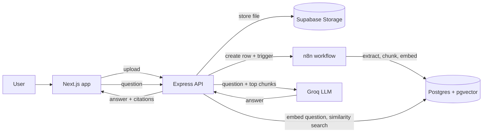

# talk-to-your-docs

A multi-tenant **RAG** (Retrieval-Augmented Generation) platform. Upload documents, ask questions in plain language, and get answers grounded in _your_ files, with citations back to the exact passages.

> **Status: Milestone 1 of 7 complete.** The data layer is built and verified. Upload, ingestion, chat and UI are next. See the [roadmap](#roadmap).

---

## How it works



1. **Ingestion:** a file is validated, stored, split into chunks, and each chunk is turned into a 384-number embedding that captures its meaning.
2. **Retrieval:** a question is embedded the same way, and pgvector finds the closest chunks by cosine distance.
3. **Generation:** the LLM answers using only those chunks, and the response lists which chunks it used.

## Tech stack

| Area               | Choice                                                        |
| ------------------ | ------------------------------------------------------------- |
| API                | Node.js, Express 5, TypeScript                                |
| Frontend           | Next.js 16 (App Router), Tailwind CSS                         |
| Database           | Supabase Postgres with pgvector (HNSW index, cosine distance) |
| ORM                | Drizzle                                                       |
| Auth / Storage     | Supabase Auth, Supabase Storage                               |
| Embeddings         | Supabase `gte-small` (384 dimensions, English only)           |
| LLM                | Groq (Llama 3.3)                                              |
| Ingestion pipeline | n8n (webhook-triggered)                                       |
| Repo               | npm workspaces monorepo                                       |

## Repository layout

```
apps/
  api/         Express API (health endpoints so far)
  web/         Next.js app (bare scaffold until Milestone 5)
packages/
  db/          Drizzle schema, client, withUserContext, migrations, smoke test
```

## Getting started

**Requirements:** Node.js 22.12 or newer, and a Supabase project.

```bash
npm install
cp .env.example .env     # then fill in DATABASE_URL (Supabase transaction pooler, port 6543)
npm run db:migrate       # apply migrations
npm run db:smoke         # verify pgvector, constraints and Row Level Security
npm run dev:api          # API on http://localhost:4000
```

Check it is running: `GET /health` (process is up) and `GET /health/ready` (database reachable).

### Scripts

| Command               | What it does                                    |
| --------------------- | ----------------------------------------------- |
| `npm run dev:api`     | Start the API with auto-reload                  |
| `npm run dev:web`     | Start the Next.js app                           |
| `npm run typecheck`   | Type-check every workspace                      |
| `npm run db:generate` | Create a migration from schema changes          |
| `npm run db:migrate`  | Apply pending migrations (one transaction)      |
| `npm run db:smoke`    | End-to-end database test (28 checks, cleans up) |
| `npm run format`      | Format the repo with Prettier                   |

## Data model

| Table           | Purpose                                                              |
| --------------- | -------------------------------------------------------------------- |
| `documents`     | Uploaded files and their processing status                           |
| `chunks`        | Text passages with a `vector(384)` embedding, searched by similarity |
| `conversations` | Chats, across all documents or scoped to one                         |
| `messages`      | Questions and answers, with the chunk IDs cited                      |

Every table has a `user_id` pointing at Supabase's `auth.users`.

## Security model

Tenant isolation is enforced **by the database**, not only by application code:

- **Row Level Security** on every table: users only see rows where `user_id` is their own.
- **`withUserContext`** runs each request's queries as the signed-in user, so a forgotten `WHERE` returns nothing instead of leaking data.
- **Composite foreign keys** `(parent_id, user_id)` guarantee a chunk, chat or message can never belong to a different user than its parent.
- **Least-privilege grants:** users can read chunks but never write them, and cannot forge assistant messages or server-managed fields.
- **Storage paths** must live in the owner's folder, enforced by a database check.

The smoke test proves it: user B holds a chunk with the same vector as user A's best match, and A's search (written with no `WHERE` clause) never returns it.

## Roadmap

- [x] **1. Monorepo scaffold, Drizzle schema, pgvector, RLS**
- [ ] 2. Express upload endpoint (validation, Storage, n8n trigger, JWT auth)
- [ ] 3. n8n ingestion workflow (extract, chunk, embed, insert)
- [ ] 4. RAG query endpoint (embed, search, Groq, citations)
- [ ] 5. Next.js upload and chat UI with citations
- [ ] 6. Hardening: rate limiting, logging, tests, SSL verification
- [ ] 7. Deployment and launch

## Known limitations

- `gte-small` understands English only; multilingual support is a planned upgrade.
- The API has no authentication yet (Milestone 2).
- Supabase's Data API is left exposed during the training phase; it is safe under RLS but bypasses API limits. Revisit before launch.

## Documentation

- [`PROJECT_HANDOFF.md`](PROJECT_HANDOFF.md): goals, working style, full roadmap
- [`CLAUDE.md`](CLAUDE.md): current milestone scope and settled decisions
